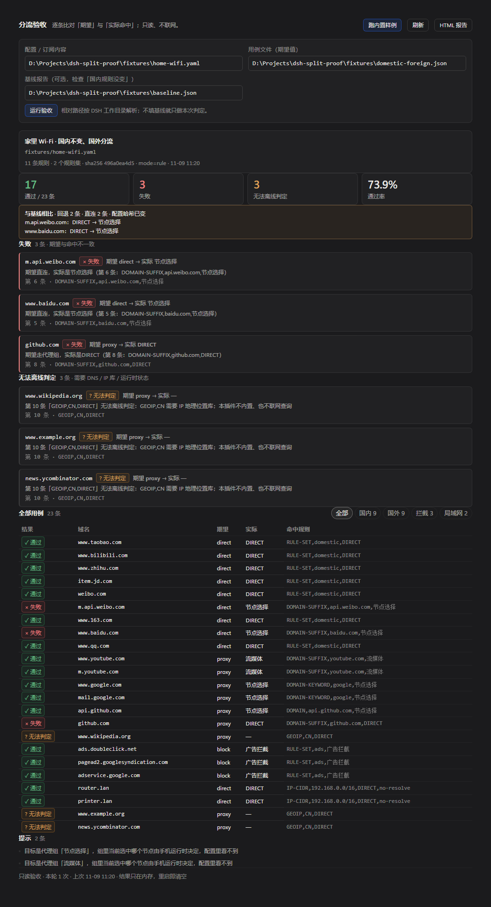
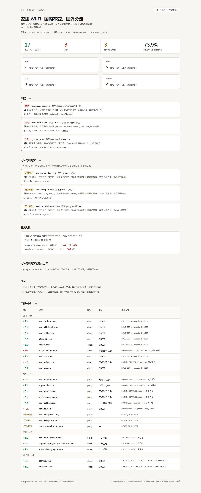

# dsh-split-proof

[](https://github.com/dingchenhui0618-arch/dsh-split-proof/actions/workflows/ci.yml)
[](LICENSE)

给 DeepSeek Harness 的**分流验收器**：读一份 Clash / Mihomo 配置和一份域名用例，
按配置里规则的真实顺序逐条求值，回答每个域名「期望走哪条路」和「实际命中哪条规则」。
**只读、不联网、不写任何设备配置。**

> 用着还行的话，点个 ⭐ 就够了——插件市场的「搜插件」按 GitHub star 排序。

## 为什么要有它

手机连家里 Wi-Fi 的「自动分流」平时只能靠手感：打开一个网站，看它卡不卡、IP 落在哪。
规则一多，没人能说清某个域名到底命中了哪一条。这个插件把这件事变成一份可复核的对照报告：

- 期望由你声明（`direct` / `proxy` / `block`，或一个具体策略名），**插件不替你猜**；
- 实际命中来自配置文件里的规则链，**带规则序号与原文**；
- 需要 DNS、IP 地理位置库或手机运行时状态才能决定的，明确标为**无法离线判定**，不猜；
- 带上一份旧报告，就能检查**「国内规则没变」**。

> 立项依据来自 2026-11-09 日报里「网络类插件只做远程连接、没人做分流命中验收」的判断。
> 那条判断**没有直接证据**，是当天的推测；本仓库不把它当已核实的事实，只描述这个工具本身做了什么。

## 它不做什么（先看这里）

- **不连接路由器、不拉订阅、不改配置。** 整个包没有 `http` / `https` / `net` / DNS 调用。
- **不是网络探针。** 报告说明「配置按规则会怎么走」，不证明手机此刻实际怎么走：代理组当前
  选中哪个节点、手机客户端实际的 `mode`，都不在配置文件里。
- **不判断某个域名「本来应该」走哪。** 期望来自用例文件；这是验收的前提，不是插件的推断。

## 安装

```sh
dsh plugin --profile <你的 profile> add github:dingchenhui0618-arch/dsh-split-proof
```

装好后重启 DSH：对话视图出现「分流验收」Tab，Agent 多一个 `split_proof` 工具。
桌面端在应用里安装插件，profile 由应用自己管理。

## 三十秒上手

面板上点「跑内置样例」即可：`fixtures/` 里有一份刻意留了两处误伤的家庭 Wi-Fi 配置、
一份用例、一份「改动前」的基线报告。

不想开图形界面就直接跑 CLI（同一个验收引擎）：

```sh
node bin/split-proof.mjs \
  --config fixtures/home-wifi.yaml \
  --suite fixtures/domestic-foreign.json \
  --baseline fixtures/baseline.json \
  --html report.html
```

退出码是接口的一部分：

| 码 | 含义 |
| --- | --- |
| 0 | 每条用例都通过 |
| 1 | 至少一条期望与命中不一致 |
| 2 | 配置 / 用例读不了、解析失败（什么都没验成） |
| 3 | 没有失败，但有无法离线判定的用例 |

## 用例文件

```json
{
  "name": "家里 Wi-Fi · 国内不变、国外分流",
  "directGroups": ["DIRECT", "直连"],
  "rejectGroups": ["REJECT", "广告拦截"],
  "cases": [
    { "domain": "www.taobao.com", "expect": "direct", "group": "国内" },
    { "domain": "www.youtube.com", "expect": "proxy", "group": "国外" },
    { "domain": "ads.doubleclick.net", "expect": "block", "group": "拦截" },
    { "domain": "github.com", "expect": "节点选择", "group": "国外" },
    { "domain": "router.lan", "expect": "direct", "ip": "192.168.1.1" }
  ]
}
```

- `expect`：`direct` / `proxy` / `block`，或一个具体策略名（精确比较）。
- `ip` / `sourceIp` / `port` / `network`：可选，能把 `IP-CIDR`、`SRC-IP-CIDR`、`DST-PORT`、
  `NETWORK` 从「无法判定」变成「可判定」——这也是它和「凭感觉」最不一样的地方。
- `directGroups` / `rejectGroups`：你自己命名的组，比如把「广告拦截」声明为拦截组。
  插件不会从中文名字猜语义。

## 报告怎么读

| 结论 | 含义 |
| --- | --- |
| **通过** | 命中规则后的目标与期望一致 |
| **失败** | 期望与命中不一致；报告给出规则序号、原文与实际策略 |
| **无法离线判定** | 链路走到了需要 DNS / IP 库 / 运行时状态的规则（`GEOIP,CN`、无 IP 的 `IP-CIDR`、远程规则集等）；不猜结果，只给原因 |
| **用例无效** | 缺 `domain` / `expect`，或域名无法规范化 |

代理组目标（例如「节点选择」）算「走代理」，但报告会注明：组里当前选中哪个节点由手机
运行时决定，配置文件里看不到。把它写进结论里，是为了不把「路由到代理组」冒充成
「出口在境外」。

## 支持的规则

`DOMAIN`、`DOMAIN-SUFFIX`、`DOMAIN-KEYWORD`、`DOMAIN-REGEX`、`RULE-SET`
（`classical` / `domain` / `ipcidr`）、`MATCH` / `FINAL`、`IP-CIDR` / `IP-CIDR6`、
`SRC-IP-CIDR`、`DST-PORT`、`NETWORK`、`GEOIP,LAN`。`PASS` 按 Mihomo 语义跳过该条继续匹配。

其余类型（`GEOIP,<国家>`、`GEOSITE`、`PROCESS-NAME`、`OR` / `AND` / `NOT`、远程规则集……）
会让用例进入「无法离线判定」并写明原因，而不是悄悄当成不命中。

规则集只读配置目录内的本地文件（`allowOutsideProviders` 可放开），单个上限 8 MiB；
`type: http` 的规则集从不联网拉取，有本地缓存时按缓存读并注明「未校验是否与订阅源一致」。

## 面板

对话视图 →「分流验收」：



## 报告页

CLI 的 `--html` 与 `GET /dsh-split-proof/report` 产出同一份自包含页面（无脚本、无外链）：



`docs/sample-report.html` 就是这份页面的静态样例，直接用浏览器打开即可。

## 开发

```sh
node scripts/build.mjs   # 零依赖构建（不需要打包器），产出 lib/
node --test              # 71 个测试
node scripts/preview-panel.mjs   # 用真实面板组件渲染 docs/panel-preview.html
node scripts/screenshot.mjs docs/sample-report.html docs/report.png 1280
```

测试覆盖 YAML 子集解析、规则类型与边界语义、规则集加载与路径限制、验收报告、基线对比、
CLI 退出码，以及 host 半区的工具/路由/卸载。`lib/` 是构建产物，改 `src/` 后必须重新 build。

## 设计参考与差异

- 工程骨架（零依赖构建、`cordis.patch.yml`、host/client 双半区、README、测试布局）照
  [dsh-warden](https://github.com/dingchenhui0618-arch/dsh-warden)——同一作者自己的项目，
  这是脚手架复用，不是把它的功能代码搬过来。
- 规则语义按公开的 Clash / Mihomo 规则模型实现（顺序、first-match、`PASS`、规则集
  behavior），**没有 clone 或整段搬运任何现有实现**。YAML 解析器、规则引擎、报告、面板、
  CLI 都是新写的。
- 和设想的差异：
  1. 设想里的「读路由与订阅」落成了「读导出的配置 + 本地规则集文件」：不连路由器、不拉
     订阅 URL，因为验收工具一旦开始联网/登录，就会碰到凭据和副作用。
  2. 设想里的「跑国内与国外域名」落成了「按用例逐条声明期望」：插件不用 TLD 猜国内国外，
     那会把猜测包装成结论。
  3. 多出来的是：命中溯源（规则序号+原文）、无法判定的显式分类、基线对比（国内规则没变）、
     自包含 HTML 报告、CLI 退出码，以及一块只读面板。
  4. 「手机连家里 Wi-Fi」这一层仍需要用户提供从客户端导出的配置；本插件不读取手机文件系统。

## 安全

只读边界、路径限制、路由的信任模型与已知限制写在 [SECURITY.md](SECURITY.md)。
一句话：它是验收器，不是安全边界；不要把它的 HTTP 路由暴露到不可信网络。

## License

MIT
